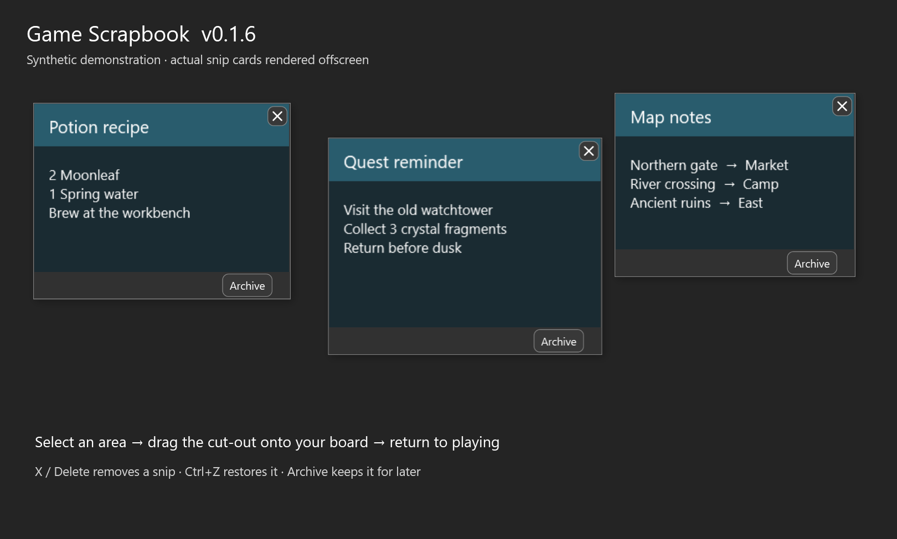

# Game Scrapbook

Keep recipes, quests, maps and other game information in view on your second monitor. Game Scrapbook is a small, portable Windows utility: capture part of your game screen, drag the cut-out onto a persistent board, then return to playing.

**Windows x64 · Public release v0.1.8 · Free and open source · MIT license**

[Download the latest Windows release](https://github.com/finalidiot/Game-Scrapbook/releases/latest) · [Report a problem](https://github.com/finalidiot/Game-Scrapbook/issues)

**Tested successfully in Nivalis Nights with v0.1.7**, including the camera/aim fix. Other games and display modes may behave differently. See the [live game validation](docs/VERIFICATION_0.1.7.md#live-game-validation).

## What it does

- **Snip the screen under your mouse.** Use a configurable global shortcut or a Snip button with a three-second countdown.
- **Place each snip yourself.** Select a rectangle, then drag the cut-out onto the board. Arrange and proportionally resize saved snips, and zoom the board from 25% to 300%.
- **Snap images together.** Nearby image edges join while you move snips. Turn **Snap edges** off or hold **Shift** while moving a saved snip to place it freely.
- **Bring the board together.** **Magnetise** pulls all active snips into a compact arrangement while preserving their sizes. One **Ctrl+Z** restores the previous layout.
- **Export one image.** Save the whole active board as a JPG or PNG, tightly cropped to the snips and without buttons, outlines or other interface controls.
- **Keep snipping input out of your game.** After taking the screenshot, the selection overlay temporarily takes focus while you select and drag. When you finish or cancel, the app attempts to return to the original game window. It can also return the mouse to its starting position before restoring game focus.
- **Archive information for later.** Clear individual snips from the board without losing them. Browse thumbnails, view an image at Fit or 100%, and restore it to its saved position and size.
- **Edit with undo and redo.** Delete with the centered X on a snip, the toolbar, or the Delete key. Undo and redo cover snip changes, including archiving and restoring.
- **Keep your setup.** Images, layout, archives, window placement, zoom and settings save locally. Choose background, text and accent colours, and optionally keep the scrapbook on top.

The app has no account, upload, cloud sync or network feature. Your captures stay on your computer.



*Historical v0.1.6 demonstration with synthetic content, not a live game screenshot. In v0.1.8, **Archive selected** is in the toolbar so image edges can join without a footer between them.*

## First run

1. Download the Windows x64 ZIP from [Releases](https://github.com/finalidiot/Game-Scrapbook/releases). Close any older running copy of Game Scrapbook, then extract the complete ZIP to a folder.
2. Open `GameScrapbook.exe`. The header should show **v0.1.8**. The portable release includes its .NET runtime; you do not need to install one separately.
3. Put the scrapbook window on your second screen. A new setup attempts to start there automatically. Begin with your game in **windowed or borderless mode with SDR output**.
4. Select your game, put the mouse on the screen you want to capture, and press **Ctrl+Alt+S**. Alternatively, click **Snip**, then move the mouse to that screen during the three-second countdown.
5. **Drag a rectangle** around the information you want, then release.
6. **Grab the bright cut-out and drag it again**, this time onto the scrapbook board. Release to place and save it. The app attempts to return focus to your game.

There are two drags: the first selects an area; the second carries that cut-out to the board. Dropping outside the board leaves the cut-out available to try again. The captured monitor is chosen from the pointer position when capture starts.

The screenshot is taken before focus moves away from the game. The snipping overlay then takes focus for selection and dragging so foreground-only game input does not keep turning the camera. A game may pause when it loses focus, according to its own settings. If Windows will not give the overlay focus, capture stops instead of leaving the game active during the drag.

Keep the app running for its global shortcut to work. Closing its main window exits the app. Existing boards, archives and settings use the same data folder when upgrading.

## Snap, magnetise and export

Leave **Snap edges** checked to align nearby image edges while moving or placing snips. Alignment guides show a snap while you move a saved snip. Hold **Shift** during that move to bypass snapping temporarily, or uncheck **Snap edges** to turn it off. The checkbox choice is remembered between launches.

Snapping aligns individual images; it does not make a permanent group. You can still move, resize, archive or delete each snip separately. Select an image and use toolbar **Archive selected** to put it away. Moving that action to the toolbar allows images to meet directly along both horizontal and vertical edges.

Click **Magnetise** to bring every active snip, including those outside the current view, into a compact arrangement at the top-left of the board. It preserves image sizes and leaves archived snips alone. **Ctrl+Z** restores the previous arrangement in one step, and **Ctrl+Y** reapplies it.

To save a combined image, click **Export image**, choose a filename and select **JPG** or **PNG**. JPG uses quality 95; PNG is lossless. Both use your current board background colour as a solid background.

The export contains **all non-archived board snips**, including images outside the scrolled view. It crops away the empty canvas around them, preserves intentional gaps and overlapping images, and keeps a selected overlapping snip on top just as the board shows it. Archive/Delete buttons, resize grips, selection outlines, alignment guides and the dotted canvas are excluded. Exporting leaves the individual snips on your board.

Snip sizes on the board determine the exported image dimensions. Board zoom and scroll position do not change the file. Export limits are 32 million output pixels, 32,767 pixels per edge and 64 million pixels of unique source-image data. If the output is too large, bring snips closer together or resize them; archive some snips if the source-data limit is reached. A missing active image stops the export rather than producing an incomplete file.

## Controls and shortcuts

| Action | Control |
| --- | --- |
| Start a capture | **Ctrl+Alt+S** by default; change it in Settings |
| Start without a shortcut | **Snip**, then move to the desired screen during the countdown |
| Cancel a capture | **Escape**, right-click, or press the capture shortcut again |
| Cancel the button countdown | Click **Cancel** or press **Escape** in the scrapbook |
| Place a new snip | Drag the selected cut-out onto the board |
| Select / move a saved snip | Click / drag it |
| Resize a saved snip | Select it, then drag its bottom-right grip; proportions stay intact |
| Snap nearby image edges | Leave toolbar **Snap edges** checked |
| Move a saved snip without snapping | Hold **Shift** while dragging, or turn **Snap edges** off |
| Bring all active snips together | Toolbar **Magnetise**; **Ctrl+Z** restores the old layout |
| Save the combined board | Toolbar **Export image**, then choose JPG or PNG |
| Delete a snip | Its top-right **X**, or select it and use **Delete** / toolbar **Delete** |
| Undo / redo | **Ctrl+Z** / **Ctrl+Y** while editing the board |
| Clear selection | Click empty board space or press **Escape** |
| Zoom the board | **Ctrl+mouse wheel** over the board, or toolbar **− / +** |
| Reset zoom | Click the toolbar percentage button |
| Archive a snip | Select it, then click toolbar **Archive selected** |
| Browse / restore archives | Toolbar **Archive (count)**, select an image, then **Restore to scrapbook** |

The X deletes that particular snip immediately, without selecting it first or opening a confirmation dialog. On very small snips, select the image and use **Delete** or toolbar **Delete** if the X is hidden. **Ctrl+Z** restores it during the current session. Undo history is limited to 100 changes and does not survive closing the app; it does not undo colour settings, snapping preferences or window placement.

Clicking or moving existing snips keeps focus in the scrapbook for editing. Automatic focus return applies to capture, rather than ordinary board editing. Close Archive or Settings before starting another capture.

## Settings

Open **Settings** to change the capture shortcut, **Return mouse after snipping**, or **Keep scrapbook on top**.

Under **Appearance**, choose Background, Text and Accent colours from swatches or enter a `#RRGGBB` value. A contrast hint helps keep text readable. **Save settings** applies and remembers your choices; **Cancel** discards them. **Reset to blue, white and dark grey** restores the default palette when saved.

## Saved data and backups

Open **Settings → Open saved-board folder** to find `%LOCALAPPDATA%\GameScrapbook`:

| Item | Contents |
| --- | --- |
| `board.json` | Layout, archive state, snapping preference and settings |
| `board.backup.json` | Previous successfully saved layout |
| `images/` | Captured PNG images |
| `diagnostics.log` | Error details, when errors occur |
| `capture-diagnostics.log` | Capture startup events, screen bounds, overlay geometry and errors |

To back up or move your scrapbook, close the app and copy the entire data folder. The app tries the previous save if the current layout is unreadable, preserves unreadable files, and disables editing if neither layout can be recovered. Missing images appear as placeholders while their saved positions are retained.

**Deleting a card does not erase its PNG from disk.** Images remain available for undo and previous-save recovery. Unused PNG files are not automatically purged. Do not remove image files manually while the app is running.

Capture diagnostics do not record screen contents or window titles. Before sharing logs or a data folder in a public issue, check it for personal information and screenshots you do not want to publish.

## Compatibility and limitations

- Windows x64 is required to run the WPF application. Windows 10/11 with windowed or borderless SDR games is the intended target; actual behaviour depends on the game and display setup.
- Capture uses Windows GDI desktop capture. Exclusive fullscreen, HDR colour accuracy and protected capture surfaces are not verified and may produce incorrect or blank captures.
- The snipping overlay temporarily takes focus, which can pause a game according to its unfocused-window settings. Games that read mouse input in the background may still react; games that lock the cursor may need their own menu or cursor setting. This is not a global input blocker.
- Windows may refuse a focus-transfer or focus-return request. Capture stops if the overlay cannot own input; the app reports a failed return instead of repeatedly forcing focus. Losing overlay focus during capture cancels the operation. An intentional Alt+Tab to another app leaves that app active without moving the pointer back.
- This is an **unsigned Windows application**. Windows may show an unknown-publisher or reputation notice. First launch can take longer while .NET extracts bundled native files.
- There is one local board. Undo history is session-only; there is no automatic unused-image cleanup.

If the shortcut seems inactive, try **Snip** and read the message above the board. **Shortcut unavailable** usually means another app has registered it; choose a different combination in Settings. Capture errors and the diagnostics above help distinguish shortcut, screenshot and overlay failures.

See [the Windows playtest checklist](docs/WINDOWS_PLAYTEST.md) for manual snapping, export, capture, monitor and focus checks. Build and test evidence for this release belongs in [the v0.1.8 verification report](docs/VERIFICATION_0.1.8.md); older reports in `docs/` describe their respective historical versions. The confirmed Nivalis Nights result above applies to v0.1.7's capture workflow; it is not a claim that every new v0.1.8 interaction has already had a live game playtest.

## Build from source

Install the **.NET 10 SDK** and PowerShell, clone this repository, and open a terminal at its root. `global.json` requests SDK 10.0.100 and permits later stable feature bands in the .NET 10 SDK family.

```powershell
.\scripts\build.ps1
```

This command runs the core and layout checks and, on Windows, the capture-lifecycle and image-export checks once, then publishes a self-contained, single-file Windows x64 executable to `artifacts/windows-x64/GameScrapbook.exe`. It downloads Microsoft's targeting/runtime packages on the first restore. The application has no third-party NuGet package dependencies.

For a checks-only run:

```powershell
dotnet run --project tests/GameScrapbook.Core.Checks -c Release
dotnet run --project tests/GameScrapbook.Layout.Checks -c Release
```

On Windows, the [capture-lifecycle checks](tests/GameScrapbook.Capture.Checks/README.md) and [image-export checks](tests/GameScrapbook.Export.Checks/README.md) can be run separately with:

```powershell
dotnet run --project tests/GameScrapbook.Capture.Checks -c Release
dotnet run --project tests/GameScrapbook.Export.Checks -c Release
```

Capture checks simulate focus, cursor and overlay operations around the real capture coordinator. Export checks use actual WPF rendering and JPG/PNG encoding with synthetic images. They do not replace a live game and board-interaction playtest.

For interactive development on Windows:

```powershell
dotnet run --project src/GameScrapbook.Windows -c Debug
```

The build script can also run under PowerShell 7 on Linux with the .NET 10 SDK; the Windows project enables cross-targeting. Running the application and testing game interaction still require Windows. No automatic GitHub Actions build workflow is included.

## Contributing

Report reproducible issues with the app version, Windows version, game display mode, monitor scaling and steps to reproduce. Please omit private captures. Small pull requests are welcome; run the core checks and use the Windows playtest checklist for changes to capture or the interface. The app's code is split between platform-independent storage/history in `src/GameScrapbook.Core` and the WPF interface/capture integration in `src/GameScrapbook.Windows`.

## License

Game Scrapbook is available under the [MIT license](LICENSE), allowing use, modification and redistribution. See [CHANGELOG.md](CHANGELOG.md) for release history.
